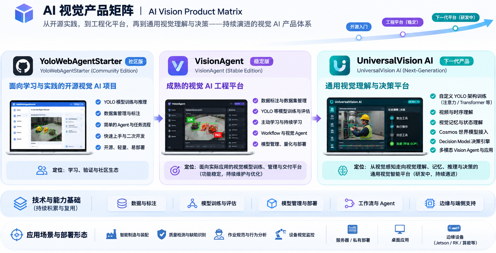
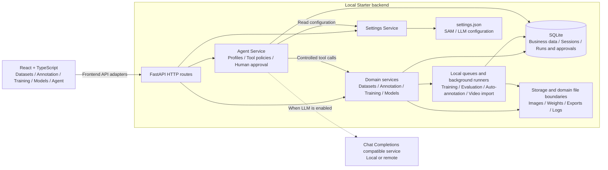
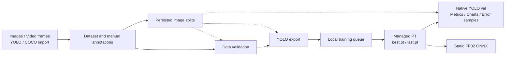
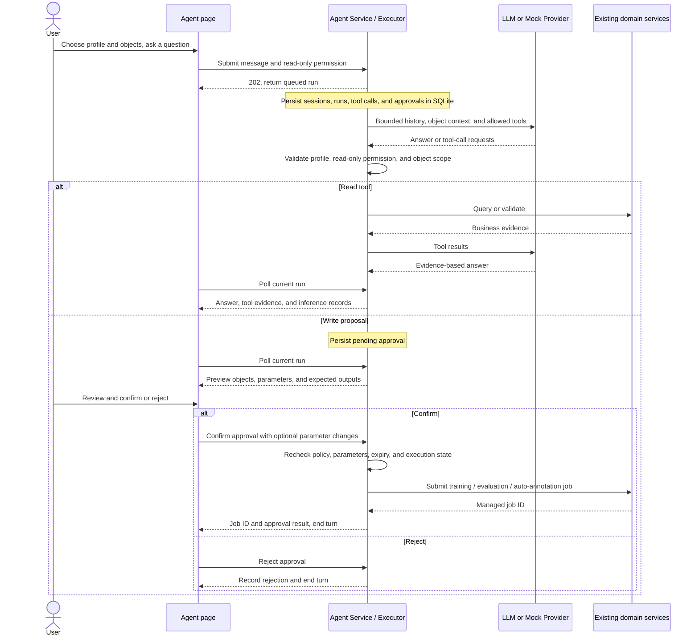

# YoloWebAgentStarter

[中文 README](README.md)

YoloWebAgentStarter is a local, single-user YOLO dataset workspace for a lightweight end-to-end workflow covering image/video-frame import, manual annotation, data validation, YOLO/COCO exchange, local training, native YOLO evaluation, and managed model artifacts, with an assistant grounded in tool evidence.

A commercial edition is also available. For details, use the contact information below; the official website link will be added later.



## Why use it

- Prepare and annotate `detect`, `segment`, `obb`, and `classify` datasets entirely on your machine.
- Reuse persisted `train` / `val` / `test` splits for validation, YOLO export, and local training.
- Provide interactive SAM suggestions for segmentation; every suggestion must be confirmed by the user and saved as a standard polygon annotation.
- Manage SAM models, inference device and image size, and the review-only fallback when no model is configured from Settings.
- Train on CPU, MPS, one CUDA GPU, or multiple CUDA GPUs; local multi-GPU training uses Ultralytics DDP.
- View and filter local backend logs by tail length, level, and content; language preference is stored locally in the browser.
- Admit only managed `best.pt`, `last.pt`, and static FP32 ONNX training artifacts into the model library.
- Run native Ultralytics `val` in the background for managed PT models, retaining metrics, logs, charts, and up to 200 reviewable error samples.
- Start local auto-annotation jobs from a dataset card: by default, existing annotations are skipped; select a compatible managed PT model, explicitly confirm class mapping, adjust confidence/IoU, optionally clear old annotations, monitor progress, and cancel when needed. Training and auto-annotation are mutually exclusive on the same machine. Results are retained with the `auto` source and must be manually reviewed before training.
- Agent MVP: four built-in assistant profiles for general, dataset, training, and model questions, with readiness, failure-diagnosis, and model-comparability reports. Write actions submit existing managed jobs after human confirmation. Sessions retain object bindings; runs support asynchronous progress, cancellation, and retries with their original mode and permissions. See the [Agent guide](docs/agent.md).
- Load long conversations on demand, search sessions, inspect per-turn evidence and approval records, and see new-reply notifications while reading history.
- Bind to `127.0.0.1` by default; data, database, exports, and training files stay local.

## Features at a glance

| Capability | Details |
|---|---|
| Datasets | Create datasets and classes, browser uploads, video frame extraction, restricted local-directory scans, persisted split management, batch/reproducible auto-splitting, read-only duplicate/similar-image reports, and derived slice datasets |
| Annotation | detect bounding boxes, segment polygons, OBB select/move/resize/rotate, and single-label classification |
| SAM | Box/point segmentation suggestions; when no model is configured, only clearly identified review-only box suggestions are available |
| Data exchange | YOLO detect / segment / OBB ZIP import and export; YOLO classify directory-layout import and export; detect/segment COCO ZIP import and export |
| Training | Local FIFO queue, CPU/MPS/single CUDA GPU/local multi-GPU DDP, logs, progress, stop controls, resume interrupted jobs or create continuation jobs from managed `last.pt`, metric summaries/trends, configuration snapshots, and best/last checkpoints |
| Settings and logs | SAM settings, Agent LLM configuration and connection testing, language settings, and local runtime-log viewing and filtering |
| Evaluation | Background native YOLO `val`, persisted splits, job state and recovery, logs, confusion matrices, available PR curves, and up to 200 error samples; segment retains separate box/mask metrics and curves |
| Models | Managed PT downloads from training artifacts, persisted image quick tests, same-dataset model comparisons, reviewable pre-annotations, auto-annotation jobs/logs, and deduplicated FP32 ONNX exports |
| Data quality | Annotation coverage, class distribution, small-object, overlapping-bbox, and class-imbalance hints |
| Agent MVP | Four built-in profiles, object-bound sessions, read-only Q&A and diagnostic reports; human-confirmed training/evaluation/auto-annotation jobs; asynchronous runs, cancellation, retries, per-turn evidence and inference provenance; paginated sessions/messages and server-side session search; LLM settings in `settings.json`, run records in SQLite, and redacted credentials and sensitive parameters in logs |
| Security boundary | Managed storage root, import-directory boundary, ZIP resource-exhaustion limits, and localhost binding by default; Agent write actions require confirmation and forbid arbitrary paths, external PT, or shell commands |

### Supported tasks

| Task | Annotation representation | YOLO exchange | Local training | Split evaluation |
|---|---|---|---|---|
| `detect` | bbox | Supported | Supported | Box P/R/mAP, charts, and error samples |
| `segment` | polygon; optional SAM suggestions | Supported | Supported | Separate box/mask P/R/mAP, RLE predictions, and charts |
| `obb` | Center, size, and angle in absolute pixels | Supported | Supported | OBB metrics, charts, and polygon-IoU error samples |
| `classify` | One class per image | Standard `split/class/image` layout | Supported | Top-1 / top-5 metrics |

Not included: login/RBAC, collaboration, Workflow, unattended Agent automation (schedules, triggers, automatic job chaining), text-prompt segmentation, Deployment, pose, cloud training, or remote distributed scheduling. The Agent must not execute arbitrary paths, external PT files, or shell commands. Auto-annotation only supports locally managed Ultralytics PT models, and its results require manual review. See the complete boundary in the [Community v2 feature matrix](phase1_scope.md).

## Architecture

### Application layers and storage

The React frontend accesses FastAPI through API adapters. HTTP routes delegate to domain services. Local jobs use queues or background runners, and file access goes through managed-storage boundaries.



The Agent defaults to built-in Mock / rule planning. All four profiles share the executor. The settings service stores LLM configuration in `settings.json`; sessions and run records reside in SQLite. Starter runs independently.

### Dataset-to-model data flow

Annotations are persisted in absolute pixels. Validation, YOLO export, and evaluation reuse the same persisted image splits. Model versions originate from managed local-training artifacts.



Each stage is user-initiated. Auto-annotation also uses managed PT models; results retain the `auto` source and require manual review before training.

### Agent queries and human approval

The Agent binds the profile, objects, and run permissions before exposing tools to the provider. Read tools gather business evidence. Write tools create approval requests, and existing jobs are submitted after human confirmation.



Submitted jobs are monitored and controlled from their respective job pages. See the [Agent guide](docs/agent.md) for run behavior, cancellation, retries, and history pagination.

## Quick start

### Prerequisites

- macOS or Linux
- Python 3.11 / 3.12
- Node.js 20+

From the repository root:

```bash
python3.12 -m venv .venv
.venv/bin/pip install -r backend/requirements.txt -r backend/requirements-dev.txt
npm --prefix frontend install
./run-backend.sh
```

Start the frontend in another terminal:

```bash
./run-frontend.sh
```

Open <http://127.0.0.1:5173>; the API is at <http://127.0.0.1:8000>. You can also run `./run-all.sh` (or `sh run-all.sh`) to start both services and stop them together with `Ctrl+C`.

> The training page supports YOLOv8, YOLO11, and YOLO26 base-weight families, matching each task by suffix. The first use of a named weight may cause Ultralytics to download it. Use weights only after confirming that their license is appropriate, and do not commit weights, datasets, or generated artifacts.

## First-use workflow

1. Create a `detect`, `segment`, `obb`, or `classify` dataset.
2. Upload images, or place images in a subdirectory of `data/imports/` and scan it in the UI.
3. Add classes and annotate them with bounding boxes, polygons, rotatable OBBs, or one classification label per image.
4. Ensure both `train` and `val` contain at least one annotated image, then run dataset validation.
5. Export/import YOLO data, or choose a compatible model family on the Training page and start a local job.
6. After training, open the Models workspace and create a background evaluation job for a managed PT model using the `train`, `val`, or `test` split.

When training completes, `best.pt` and `last.pt` are registered in the managed model directory. In the Models workspace you can download PT files, edit metadata, archive models, generate FP32 ONNX, or inspect evaluation history, native metrics, charts, logs, and error samples. Evaluation and YOLO export reuse each image's persisted split; they never randomly repartition the data.

For more detailed instructions, SAM guidance, and troubleshooting, see the [five-minute guide](docs/quick-start.md). Generate a disposable tiny detect dataset with:

```bash
./.venv/bin/python scripts/create_tiny_demo.py /tmp/ywa-tiny-demo
```

## Using the assistant

Open Agent from the sidebar for general questions, or use the assistant action on a dataset card, training page, or model page to include the corresponding object. Four built-in Agent Profiles share the LLM configuration and executor, with profile-specific tools.

| Profile | Example question | Jobs it can propose (human confirmation required) |
|---|---|---|
| General assistant | “Which datasets, training jobs, and models are available?” | Training, evaluation, auto-annotation |
| Dataset assistant | “Is this dataset ready for training?” | Training, auto-annotation |
| Training assistant | “Why did this training job fail?” | Training, evaluation |
| Model assistant | “Can these two models be compared directly?” | Evaluation, auto-annotation |

### Configuration and questions

1. The default local Mock / rule planner needs no API key. It supports tool queries, reports, and the human-confirmation flow. Select “Read-only” below the input, or use a quick prompt, for queries without write proposals.
2. To use an LLM, open Settings → Agent LLM, enable the provider, enter the API Base URL, model, and any required authentication, then test the connection and save. The current adapter uses a Chat Completions compatible interface; Agent tools require a model and service that support tool calling.
3. Select a profile and object, then ask a question. `Ctrl / ⌘ + Enter` sends the message. Changing the profile or object in an existing conversation requires starting a new chat or explicitly continuing that conversation.
4. For job requests, review the object, parameters, and expected outputs in the approval card. The domain job is submitted only after confirmation, which ends the Agent turn.
5. Inspect asynchronous progress, tool evidence, and inference provenance. Failed or cancelled runs can be retried with their original profile, object, and read-only permission. Submitted jobs are controlled from their respective job pages.

Disabling the LLM returns to local rule planning. When using an external LLM service, questions, object context, and tool results used to answer are sent to that configured service. A connection test does not verify the complete business or tool-calling flow.

### Sessions and history

- Sessions load in pages of 30. Server-side search covers all session titles and bound object IDs; it does not search message bodies or switch the current conversation.
- Opening a conversation loads the latest 50 non-tool messages. “Load earlier messages” preserves the reading position. Each turn provides expandable tool results, inference records, and approval status; historical approvals are display-only.
- Only the current run is polled each second. New replies do not force a jump while reading history; “New reply · Jump to latest” resumes following the conversation.
- Full history stays in the database, while model context has a length budget. Pagination does not give the LLM unlimited memory. Automatic summaries and list virtualization are not implemented; repeatedly loading older pages accumulates rendered messages.

Model-comparability reports check dataset, task, evaluation split, and thresholds. Evaluation records currently lack a verifiable dataset snapshot fingerprint, so matching metrics alone cannot establish a reliable ranking or model replacement. See the [Agent guide](docs/agent.md) for capabilities, history budgets, and API contracts.

## Device support

Ultralytics resolves training devices locally:

| Device | UI value | Status |
|---|---|---|
| CPU | `cpu` or `auto` | Covered by release smoke tests |
| Apple Silicon / Metal | `mps` | Passed to Ultralytics; run smoke verification on the target Mac |
| NVIDIA CUDA, one GPU | `0`, `cuda:0`, or a single GPU in the UI | Passed to Ultralytics; requires matching CUDA PyTorch, drivers, and hardware |
| NVIDIA CUDA, multiple GPUs | `0,1` or multiple GPUs in the UI | Uses `device=0,1` to trigger local Ultralytics DDP; no remote scheduling is provided |

This repository's current CI baseline is CPU. MPS and CUDA compatibility depends on the target host's PyTorch/Ultralytics combination, drivers, and available hardware.

## Configuration and data locations

All runtime data defaults to the Git-ignored `./data/` directory: the SQLite database, managed images, training jobs, exports, and model files. Common settings are below; see [backend/.env.example](backend/.env.example) for the complete example.

| Environment variable | Default | Purpose |
|---|---|---|
| `YWA_DATA_DIR` | `./data` | Starter-managed runtime root |
| `YWA_IMPORT_ROOT` | `./data/imports` | The only root accessible to server-side directory scans |
| `YWA_HOST` / `YWA_PORT` | `127.0.0.1` / `8000` | Backend bind address and port |
| `YWA_MAX_UPLOAD_MB` | `50` | Per-upload limit |
| `YWA_MAX_YOLO_ARCHIVE_*` | See example file | Count, extracted-size, and compression-ratio limits for YOLO ZIP files |
| `YWA_SAM_MODEL` | Unset | Local or named checkpoint enabling real Ultralytics SAM box/point prompts |
| `YWA_SAM_DEVICE` | `auto` | SAM device request, such as `mps` or `cpu` |
| `YWA_SAM_IMGSZ` | `1024` | SAM inference size; values saved in Settings override the environment default |
| `YWA_AGENT_PROVIDER` | `mock` | Default Agent provider; use `openai-compatible` for a real LLM |
| `YWA_AGENT_BASE_URL` | Unset | Default LLM API Base URL |
| `YWA_AGENT_MODEL` | `mock-model` | Default model; specify a model available from your service when enabling an LLM |
| `YWA_AGENT_API_KEY` | Unset | Default LLM credential; whether one is required depends on the service |
| `YWA_AGENT_MAX_TOOL_ROUNDS` | `8` | Maximum tool-inference rounds per run |
| `YWA_AGENT_APPROVAL_TTL_SECONDS` | `3600` | Approval validity period in seconds |

SAM and Agent LLM settings are stored in `YWA_DATA_DIR/settings.json` (API keys never appear in GET responses and are never written to SQLite); environment variables provide defaults. Language preference is stored only in browser localStorage. Runtime logs are saved in `YWA_DATA_DIR/logs/backend.log`, rotate at 2 MiB, and retain three backups. The log page combines the latest lines from retained files.

Before writing untrusted YOLO ZIP files, the application checks for at most 2,000 members, 100 MiB per member, 250 MiB total extracted size, and a 100:1 compression ratio. Images are streamed member by member into managed storage. Directory scans reject paths outside the import root and escaping symlinks.

## Updating an existing installation

Stop both services and back up `YWA_DATA_DIR`, including the database, `settings.json`, and managed files, before updating the code. After updating, run from the repository root:

```bash
.venv/bin/pip install -r backend/requirements.txt -r backend/requirements-dev.txt
npm --prefix frontend install
./run-all.sh
```

Normal backend startup applies pending Alembic migrations automatically. Agent history pagination uses composite indexes added by `0019_agent_history_indexes`, preserving existing records. Restart the backend after updating the frontend so the new routes and migration take effect. Unfinished Agent inference runs are marked failed after a restart and require a manual retry.

## Security and runtime boundary

This is local, single-user software. It does not provide authentication, authorization, TLS, or multi-tenant isolation. Do not bind the service to `0.0.0.0`, forward its ports, or place it directly behind a public reverse proxy.

## Evaluation implementation and artifacts

Evaluation accepts only managed Ultralytics PT models registered by Starter training jobs. An HTTP route creates the job and returns immediately; the local background runner then executes native `val`:

```text
yolo <detect|segment|obb|classify> val ... plots=True save_json=True exist_ok=True
```

- detect and OBB retain box metrics; segment parses both box and mask precision, recall, mAP50, and mAP50-95; classify retains top-1 and top-5.
- Artifacts are served through the managed artifact API; requests cannot access files outside the evaluation directory. General tasks use `PR_curve.png`; with Ultralytics 8.4.115, segment uses `BoxPR_curve.png` and `MaskPR_curve.png`, which the UI displays separately.
- `predictions.json` is analyzed according to the real Ultralytics 8.4.115 format: detect uses top-left `xywh`, segment uses pycocotools RLE masks, and OBB uses `rbox` / `poly`.
- Error samples include missed detections, false positives, and low-confidence results. The analyzer uses labels from the same exported split and persists at most 200 records. Classify currently shows native metrics only and does not create object-level error samples.
- After a service restart, running jobs are marked failed with their error retained; jobs that have not started are resubmitted to the local runner.

Charts appear only when Ultralytics actually generates them. For example, a tiny random model with no valid true positives may not create PR curves, while still producing metrics, logs, a confusion matrix, and prediction JSON.

## License and provenance

See [LICENSE](LICENSE), [NOTICE](NOTICE), and [THIRD_PARTY_NOTICES.md](THIRD_PARTY_NOTICES.md) for licensing, provenance, and third-party dependency notices.

## Project layout

```text
backend/app/       FastAPI, domain services, SQLite/Alembic, local training queue, and evaluation runner
frontend/src/      React annotation workspace, training, model management, evaluation details, and Agent UI
scripts/           Tiny-dataset, four-task CPU-training/segment-val smoke-test, and release-gate scripts
docs/              Quick start, Agent guide, dependency audit, and source/provenance materials
data/              Default runtime directory (ignored; do not commit)
```

Backend routes only adapt HTTP. Dataset, annotation, training, and file access are handled by domain services and managed-storage boundaries.

## Development and verification

Always use the repository's `.venv`, and run the following before committing:

```bash
PYTHONPATH=backend .venv/bin/pytest backend/tests
npm --prefix frontend test
npm --prefix frontend run build
PYTHONPATH=backend .venv/bin/python scripts/run_cpu_smoke.py
```

The standard tests directly invoke the Ultralytics 8.4.115 detect, segment, and OBB validators to generate the real JSON contract, then validate it with the error-sample analyzer. The CPU smoke test actually runs one tiny training epoch for all four tasks, uses native parameters to run segment `val(save_json=True, plots=True)`, and verifies eight box/mask metrics, pycocotools RLE, the confusion matrix, prediction JSON, and detect ONNX export. The smoke test uses temporary directories and retains neither models nor datasets. The first run may wait for the Matplotlib font cache and ONNX export.

Agent automated tests use the Mock Provider and require no real LLM API key. They cover tool policies, object binding, human approvals, run recovery, and history pagination. Real-provider connectivity and model tool-calling support require separate verification.

Tiny offline random models are not guaranteed to produce valid true positives, so the CPU smoke test does not require PR curves. The Ultralytics 8.4.115 naming contract for `BoxPR_curve.png` / `MaskPR_curve.png` is covered by focused tests. See [CONTRIBUTING.md](CONTRIBUTING.md) and [CHANGELOG.md](CHANGELOG.md) for details.

## Contact information
wechat：fengzhizi715

Email：fengzhizi715@126.com

## Contributing

Contributions are welcome for in-scope bug fixes, tests, documentation, and local single-user experience improvements. Before submitting:

1. Keep functionality within the [Community v2 scope](phase1_scope.md); discuss new task types, authentication, cloud services, or workflow capabilities first.
2. Add focused tests for behavior changes and run the verification commands above.
3. Do not commit model weights, datasets, customer materials, credentials, build logs, or absolute paths.
4. Preserve and update source records, and keep the project independently runnable.

See [CONTRIBUTING.md](CONTRIBUTING.md) for the full contribution guidelines.
